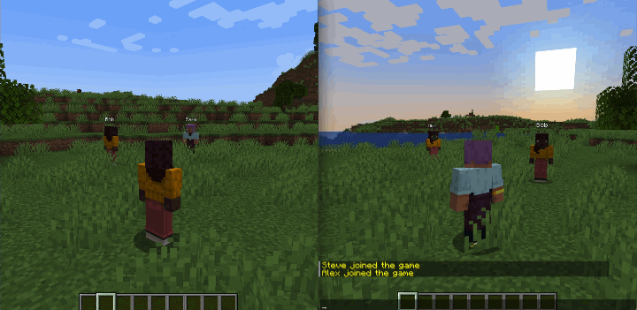
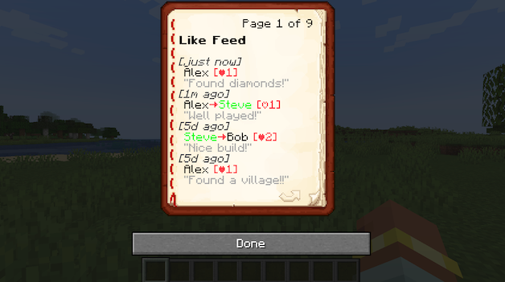
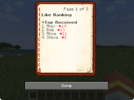
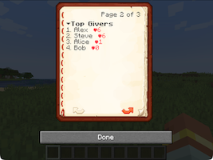
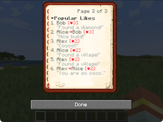
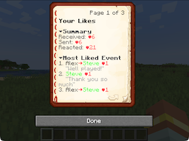
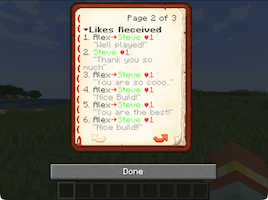
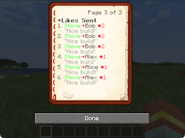
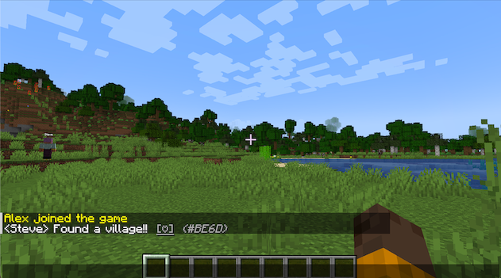

# LikeBeacon

LikeBeacon is a Minecraft Paper plugin for sharing appreciation in your community. Players can send a Like with a message, react to chat, and revisit positive moments in one shared feed.



## What players can do

- **Send a Like** — thank another player with `/like <player> <message>`.
- **Like a chat message** — click the `[♡]` shown beside eligible messages.
- **React again from the feed** — open `/like feed` and click a heart on any direct Like or liked chat message.
- **Celebrate the community** — browse rankings with `/like ranking` and personal activity with `/like mine`.

The first Like on a chat message adds it to the shared feed. Messages nobody Likes are never stored. Successful Likes provide immediate feedback, notify the recipient, and can play heart and firework particles.

## Book UI

The feed, rankings, and personal statistics use Minecraft's native book UI.

### Feed

`/like feed` brings direct Likes and liked chat messages together, with reaction counts and clickable hearts.



### Rankings

`/like ranking` shows top receivers, top direct-Like senders, and the community's most-reacted items.





### Personal statistics

`/like mine` summarizes the Likes you have received, sent, and reacted to, plus your most-liked item and recent activity.





## Built for server communities

- Spam protection with a daily direct-Like limit and per-player-pair cooldown
- English and Japanese messages selected from each player's client locale
- Compatibility-minded chat integration that preserves existing formatting
- Clickable controls, with optional display codes for clients that cannot use chat click events
- SQLite persistence and `server-id` isolation for multi-server networks
- Configurable effects and aggregated notifications to reduce chat noise

## Installation

### Requirements

- Java 21 or later
- Paper 1.21.4 or later (1.21.x)

### Steps

1. Download the latest release JAR.
2. Copy it into the server's `plugins/` directory.
3. Start or restart the server.
4. Optionally edit `plugins/LikeBeacon/config.yml`, then restart or reload the plugin.

## Commands

All commands require `likebeacon.use`, which is granted to all players by default.

| Command | What it does |
| --- | --- |
| `/like <player> <message...>` | Send a direct Like |
| `/like #<code>` | Like a pending chat message or react to a feed item |
| `/like feed` | Open the shared feed |
| `/like ranking` | Open community rankings |
| `/like mine` | View your personal statistics |
| `/like log` | Show the five most recent feed items and their display codes in chat |

Tab completion includes subcommands, online players, and recent display codes after entering or selecting `#`.

### Permissions

| Permission | Default | Purpose |
| --- | --- | --- |
| `likebeacon.use` | Everyone | Use all `/like` commands |
| `likebeacon.admin` | Operators | Administrative access |
| `likebeacon.limit.bypass` | Operators | Bypass the daily direct-Like limit |

## Configuration

LikeBeacon creates `plugins/LikeBeacon/config.yml` on first run. The defaults work without any setup; these options let server owners adjust moderation, presentation, and chat behavior.

### Limits and storage

| Key | Default | Purpose |
| --- | --- | --- |
| `server-id` | `default` | Keeps Like data separate between servers sharing a network |
| `limits.dailyDirectLikeLimit` | `20` | Direct Likes each player may send per UTC day |
| `limits.pairCooldownSeconds` | `60` | Seconds before a player may directly Like the same recipient again |
| `recent.bufferSize` | `100` | Recent feed items kept in memory after startup |
| `reason.maxLength` | `48` | Maximum direct-Like message length |

The daily limit can be bypassed with `likebeacon.limit.bypass`. Pair cooldowns reset when the server restarts.

### Presentation and notifications

| Key | Default | Purpose |
| --- | --- | --- |
| `item.prefix` | `""` | Optional prefix for direct-Like announcements and recipient notifications |
| `item.showDisplayCode` | `false` | Show reaction codes in regular messages and feedback |
| `effects.enabled` | `true` | Show heart and firework particles to recipients |
| `notifications.reactionAggregation.enabled` | `true` | Combine reactions to the same feed item into fewer notifications |
| `notifications.reactionAggregation.quietSeconds` | `3` | Send a batch after this many seconds without another reaction |
| `notifications.reactionAggregation.maxWaitSeconds` | `10` | Maximum time to wait before sending a batch |

### Chat Likes

| Key | Default | Purpose |
| --- | --- | --- |
| `chat.enabled` | `true` | Add Like controls to eligible chat messages |
| `chat.minLength` | `5` | Minimum plain-text message length eligible for a Like |
| `chat.pendingBufferSize` | `30` | Unliked chat messages retained temporarily in memory |
| `chat.maxStoredLength` | `100` | Maximum length stored after a chat message receives its first Like |

Stored chat text is limited to 1–100 user-perceived characters. Line breaks are replaced with spaces and truncated text ends with `…`.

Language is selected automatically from the player's Minecraft locale. `en_US` and `ja_JP` are included; all other locales fall back to English.

## Behavior notes

### Chat compatibility

LikeBeacon adds its control to the `ChatRenderer` already installed on Paper's `AsyncChatEvent`, so formatting from preceding chat plugins is preserved. Authors do not see a Like control on their own messages.

Paper cannot universally identify staff, party, guild, or local channels. If another plugin uses private channels or replaces the renderer later in the event pipeline, test the combination on your server or set `chat.enabled: false`.

Pending chat messages exist only in memory. The first reaction saves the message and reaction together in SQLite; messages that leave the pending buffer without a Like are never stored.

### Display codes

Clickable hearts work even when codes are hidden. For Bedrock/Geyser players or other clients that cannot use click events, enable:

```yaml
item:
  showDisplayCode: true
```

Players can then enter `/like #<code>` instead. `/like log` always shows codes, regardless of this setting.



### Notifications

Direct Likes are announced to online players other than the sender and recipient. Chat Likes and later reactions are private to the reacting player and recipient.

The first Like on a chat message is delivered immediately. Later reactions to an existing item can be aggregated, while each reacting player still receives immediate confirmation. For a direct Like from A to B, B remains the recipient of any later reactions.

### Statistics

- **Received** — reactions on the player's direct Likes and chat items
- **Sent** — direct Likes started by the player
- **Reacted** — reactions made by the player, including a direct Like's initial reaction

## Troubleshooting

### The `[♡]` control does not appear

Check that `chat.enabled` is `true`, that the message meets `chat.minLength`, and that you are viewing another player's message. If a chat plugin replaces the renderer or routes the message through a private channel, the plugins may not be compatible for that channel.

### A code no longer works

Only the latest `chat.pendingBufferSize` unliked messages remain available. When an older message leaves that buffer, its code may be reused and the message cannot be liked unless it had already entered the feed.

### Japanese text is garbled

Translation files are UTF-8. Check the server console and log encoding (for example, `-Dfile.encoding=UTF-8`) and the client or resource-pack font.

### Configuration changes are not applied

Restart the server or reload the plugin after editing `config.yml`.

### Where is Like data stored?

Data is stored in `plugins/LikeBeacon/likebeacon.db`. To reset it, stop the server and delete that file; LikeBeacon creates a new database on the next startup. Changing `server-id` selects a separate logical data set without deleting the existing one.

## Anonymous metrics

LikeBeacon uses [bStats](https://bstats.org/plugin/bukkit/LikeBeacon/34704) for anonymous environment and usage statistics such as plugin, server, Java, and operating-system versions and player count. It does not send player names or UUIDs, chat content, Like messages, `server-id`, or server addresses.

Server owners can disable bStats globally with `enabled: false` in `plugins/bStats/config.yml`. See the [bStats information for server owners](https://bstats.org/docs/server-owners).

## Development

Build the plugin with Java 21 or later:

```bash
./gradlew build
```

The shaded JAR, including the SQLite JDBC driver, is written to `build/libs/LikeBeacon-<version>.jar`.

For local testing, `./gradlew deployToTestServer` copies the JAR and a fresh config to `paper-test/plugins/`. Start your Paper 1.21.x test server from that directory and use two Minecraft accounts to exercise multiplayer interactions.

## Support

Report bugs and request features through [GitHub Issues](https://github.com/biga816/likebeacon/issues). Bug reports should include the server and LikeBeacon versions, installed plugins, reproduction steps, and relevant logs.

## License

LikeBeacon is available under the [MIT License](LICENSE). The bStats license notice is included in [THIRD_PARTY_NOTICES.md](THIRD_PARTY_NOTICES.md).
